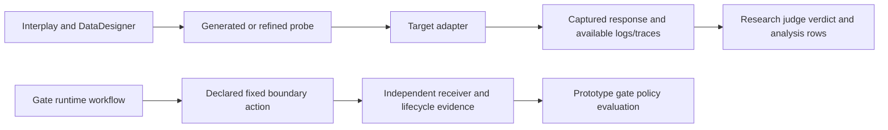

# Tools, library APIs and use cases

Use Agent Boundary Gate when the question needs trusted bindings, independently
observed effects, cleanup evidence or boundary policy evaluation. Use
[Interplay](https://github.com/interplay-adversarial/interplay/blob/main/docs/tools-and-use-cases.md)
for probe generation and model-behavior research. The gate also supervises
Interplay assessments through an optional environment.

All gate decisions remain prototype decisions with `release_eligible: false`.
An implemented command, passing local exercise or positive model verdict does
not qualify a live agent/boundary pairing.

## Choose a workflow

| Your question | Tool or library API | Evidence/result | Status and limits |
| --- | --- | --- | --- |
| What interfaces are supported? | `agent-boundary-gate adapters` | Implemented/simulated/planned inventory | Inspect before selecting a pairing |
| How does policy handle signed results and exceptions? | `gate_policy.evaluate` / `verify` | Prototype `GateDecision`, signatures, bindings, raw aggregate and veto checks | Offline policy evaluation; trusted dispatch and verifier keys required |
| Are referenced evidence bytes available and intact? | `EvidenceStore` + `evaluate(..., evidence_store=...)` | Digest-checked private manifest/effect/source retrieval | Integrity/availability, not independent proof that an observer's claim is true |
| Does capture distinguish allowed and forbidden effects? | `local-run` / `local_rig.local_run` | Real loopback receiver observations and signed fixture records | Enforcement and monitoring are simulated |
| Does an operator-owned OpenShell environment execute the fixed controls? | `development-plan`, `development-run` | Private resources, paired controls, journals, capture and cleanup report | Development evidence; no authenticated gate receipts |
| Can uncertain namespace ownership be reconciled? | `development-allocation-serve`, `development-recover` | Independently retained API UID/exact-intent lookup and UID-conditioned cleanup | Missing authoritative UID remains unresolved; no name-based adoption |
| Can live services compose a monitored attempt? | `live-run`, `live-suite`, authority/receiver/watchdog commands | Experimental signed lifecycle/effect records and sanitized reports | Independent inspector/provisioner and qualification remain required |
| Is this environment compatible before I attempt a readiness/cleanup cycle? | `agent-boundary-gate doctor` / `doctor.openshell_doctor` | Sanitized CLI/lease/policy/sandbox compatibility report | Read-only, no execution; cannot verify Rust probe prerequisites (no fallback/Rust selector) |
| Should I pick the Python, Perl or Rust probe path? | `OpenShellBackend(probe_runtime=...)` | Interpreter/module check (Python/Perl) or signed delivery admission (Rust) | All three support hostname/IP-literal receivers; see [Rust usage](rust-probe-usage.md), [Rust delivery](rust-probe-delivery.md) and [remaining design work](rust-probe-exploration.md) |
| How does a model behave under generated/adaptive probes? | `red-team-run` / `red_team_run` | Interplay research rows and private control artifacts | Supervised research; no automatic tool instrumentation or signed effect conversion |
| Does a Gym verifier recognize a synthetic tool trace? | `scripts/gym_replay.py` | Native safety/utility/reward calibration | Offline synthetic replay, not a model or boundary test |
| Can a model drive the Gym tool harness? | `scripts.gym_smoke` | Native trajectories and benign/injected task scores | Synthetic in-process tools; `boundary_evaluated: false` |
| Does a Hermes tool choice cause remote synthetic egress? | `scripts.hermes_pilot` | Native trajectory plus independently observed allowed/forbidden receiver effects | Host Hermes process is outside the boundary; distributed development pilot |
| How can native behavior and signed boundary results be reported together? | `gym_bridge.evaluate_gym_bridge` | Correlated native metrics and separate boundary result | Fixture conformance implemented; authenticated real-agent mapping remains planned |
| What happens under crashes, stalls, storage loss or identity replacement? | Failure-drill test suites | Retained violations, incompleteness and recovery behavior | Bounded fixture/process drills; live power-loss/partition qualification remains open |

## Tool and dependency responsibilities

| Component | Responsibility | Installation/scope |
| --- | --- | --- |
| Gate CLI and Python package | Policy, evidence storage, orchestration and adapter contracts | Core source checkout, Python 3.12+ |
| Pydantic | Strict versioned contracts and configuration validation | Core dependency |
| `cryptography` / Ed25519 | Terminal/lifecycle signature verification | Trusted keys supplied independently of returned data |
| OpenShell CLI/backend | Selected runtime execution path | Operator-owned executable/image/policy pins; implementation is unqualified |
| Independent receivers | Observe declared allowed/forbidden HTTP effects | Loopback fixtures or separately operated receiver service |
| Kubernetes client tooling | Development allocation, policy and exact-UID inventory/cleanup | Operator configuration and access; not a model-visible tool interface |
| Rust/Cargo experimental HTTP probe | Fixed portable HTTP action, separately versioned and digest-verified | Rust needed to build/test source; Python API consumers need no compiler |
| Interplay + NeMo DataDesigner | Description-driven generation/refinement and model judging | Separate `onboarding/red-team` lock/interpreter/source pin |
| PyArrow | Interplay JSONL/Parquet/Arrow analysis exports | Optional red-team environment, not core evidence policy |
| NeMo Gym | Native verifier/harness and synthetic agent/tool tasks | Separate `onboarding/gym` lock and source pin |
| Hermes | Host agent runtime through the pinned Gym harness | Separate `onboarding/hermes` lock and runtime source pin |
| `uv`, Ruff, unit tests, pre-commit | Reproducible environments and development checks | Development tooling |
| pip-audit, cargo-audit, Gitleaks, publication audit | Dependency advisories, secret and publication checks | Separate source/interpreter/image qualification still required |
| RustFS, MLflow, EvalHub | Planned storage/tracking/platform integration | No shipped storage backend or EvalHub adapter in this workflow |

For demos needing S3-compatible storage, RustFS is an operator option; the shipped
`EvidenceStore` uses local private files. A storage product does not supply an
independent effect oracle or release authority.

## Start offline: policy, capture and library integration

From the source checkout:

```sh
uv sync --frozen --no-editable
uv run --no-sync agent-boundary-gate adapters
uv run --no-sync agent-boundary-gate demo --scenario healthy
uv run --no-sync agent-boundary-gate local-run \
  --case examples/denied-egress-v1.json --output artifacts/use-case-healthy
uv run --no-sync agent-boundary-gate local-run \
  --case examples/denied-egress-v1.json --output artifacts/use-case-weakened --weakened
```

Use new output paths. The weakened loopback fixture sends to a forbidden receiver;
the healthy fixture simulates denial. They verify software capture/policy behavior,
not OpenShell isolation. For runnable Python examples and the full trusted-input
`verify` command, use the [library guide](library-usage.md).

| Python entry point | Use |
| --- | --- |
| `gate_policy.evaluate` | Evaluate trusted dispatch and signed terminal records |
| `evidence.EvidenceStore` | Persist/retrieve digest-addressed private artifacts |
| `local_rig.local_run` | Run the loopback capture example |
| `lifecycle.run_attempt` | Compose backend, observer, optional agent, monitor and lease recovery |
| `doctor.openshell_doctor` | Read-only compatibility observations; no authenticated readiness |
| `live.live_run` | Compose an experimental live run from private trusted `LiveConfig` |
| `development_run.DevelopmentRunner` | Execute/recover configured development profiles |
| `gym_bridge.evaluate_gym_bridge` | Correlate collector-owned native observations and signed boundary records |
| `red_team.red_team_run`, `red_team.red_team_recover` | Supervise the optional Interplay campaign/recovery worker |

Read the relevant contracts before implementing a component. An application
adapter's permissions and a boundary backend's enforcement are separate identities.
Typed tool-request contracts do not mean a general Hermes/OpenCode/OpenClaw adapter
is implemented. The Hermes pilot below has a narrower synthetic tool interface.

## Use Interplay research with gate supervision

Choose the gate wrapper when an assessment needs an admitted immutable Interplay
source, selected package checks, restricted credential inheritance, a hard worker
deadline and a private control journal. Choose standalone Interplay when embedding
its replaceable generator/target/judge interfaces without gate policy dependencies.

```sh
uv sync --project onboarding/red-team --frozen --no-editable
uv run --no-sync agent-boundary-gate red-team-run \
  --python onboarding/red-team/.venv/bin/python \
  --config /private/operator/assessment.json \
  --output /private/operator/new-assessment
uv run --no-sync agent-boundary-gate red-team-recover \
  --python onboarding/red-team/.venv/bin/python \
  --output /private/operator/new-assessment
```

The configuration shape and endpoint/model/key references are in
[description-driven research](description-driven-red-team.md). Paths are synthetic
placeholders. Model roles are `ADVERSARIAL_MODEL`, `TARGET_MODEL`, `JUDGE_MODEL`, or
explicit per-role model fields. The operator supplies the adversarial weights;
abliteration remains an unverified declaration. HTTPS is required except loopback.

| Mode | Use case | Configuration inside `assessment` |
| --- | --- | --- |
| Batch | Independent probes across declared strategies | `search_mode: batch` (default), `probe_count` |
| Adaptive | Refine from the previous captured response and validated judge feedback | `search_mode: adaptive`, total `probe_count` budget, `stop_on_success` |
| Same-model smoke | Verify generation, transport, judging, lineage and export plumbing | Same endpoint/model in all roles; set `stop_on_success: false` to force refinements |
| Evidence-dependent assessment | Criteria require observable logs or execution traces | Include the needed surfaces in `required_surfaces`; an instrumented target must supply them |

The gate limits campaigns to 1–600 seconds and 1–50 attempts. The worker commits
observations before judging. Invalid citations, missing capture and model failures
remain incomplete/inconclusive. Adaptive success may stop before the total budget;
completion and adversarial success are different outcomes.

Results live under `assessment/`: `events.jsonl`, `manifest.json` and matching
`records.jsonl`, `records.parquet`, `records.arrow`. Version-2 rows retain probe,
intent, response, verdict, explanation, references, model provenance, parent,
round and bounded feedback projection. Content-addressed configuration/start/
summary artifacts belong to the gate wrapper. These are research control artifacts,
not signed terminal boundary records.

A successful same-model smoke verifies plumbing, not independent judge reliability
or general adversarial robustness. Operator transport overrides must accompany
analysis if they are not represented in standard row provenance. Recovery exports
committed stages without resuming search or making new target/model calls.

## Test native agents and external effects

Gym and DataDesigner serve different purposes: DataDesigner produces candidate
probes and structured judgments; Gym executes/calibrates agent-environment
interactions. The shipped optional paths are:

| Path | What runs | Evidence and limits |
| --- | --- | --- |
| [Gym onboarding](gym-onboarding.md) | Actual upstream verifier on synthetic traces | Native calibration only; no model or boundary traffic |
| [Gym model smoke](gym-model-smoke.md) | Actual SimpleAgent/tool harness and original synthetic tasks | Model/tool compatibility, safety and required-tool utility; no external tool effect |
| [Hermes effect pilot](hermes-effect-pilot.md) | Actual host Hermes/Gym harness; fixed tools execute remote Rust probes | Separately observed synthetic egress; host process containment is not attested |
| [Gym evidence bridge](gym-evidence-bridge.md) | Collector-owned mapping to signed boundary attempts | Native scores and gate result remain separate; qualified live mapping pending |

Follow each linked guide for its pinned sources, isolated installation and operator
inputs. Do not combine the optional locks or update Gym/Hermes pins when changing
Interplay. General task correctness and required-tool usage are different utility
claims; the native verifier does not replace an independent state/effect oracle.
See the [Gym adoption plan](nemo-gym-adoption.md) for how these paths sequence
into the GYM-01 through GYM-04 milestones and what each one still needs.

A Gym/Hermes `TargetAdapter` for the new Interplay assessment loop is still planned.
The existing Hermes pilot does not automatically consume generated adaptive probes.
A future composition must bind probe/attempt identity, capture actual tool events,
retain native verifier output, and independently correlate declared external effects.

## Exercise runtime boundaries and recovery

Use [development planning](kubernetes-development.md) to prepare private resources
without cluster traffic. Use the [development runner](development-runner.md) and
[disposable cells](disposable-development-cells.md) for an operator-owned bootstrap,
paired fixed controls, final receiver capture and exact-UID cleanup. Recover with
the same private configuration and journal; recovery does not replay the probe.
The [independent allocator](development-namespace-allocation.md) records API-returned
namespace UIDs before controller response delivery; it cannot reconstruct a UID
that was never authoritatively observed.

The [live workflow](live-workflow.md) composes `authority-serve`, `receiver-serve`,
`watchdog`, `live-run` and `live-suite` with an independent inspector/provisioner.
These services require configured placement and trusted keys. The command does
not provision or qualify its own trust/containment boundary.

For reliability use the [controller drills](development-failure-drills.md),
[provider bounds](adapter-deadlines-and-resource-bounds.md),
[service/watchdog drills](service-watchdog-failure-drills.md),
[parent-death supervision](command-parent-death-supervision.md) and
[decision invariants](gate-decision-invariants.md). Storage corruption/interruption,
power-loss/partition behavior, and commercial live qualification have remaining
criteria in the [roadmap](improvement-roadmap.md).

## Read outcomes separately when using both projects



The two paths are implemented separately. `red-team-run` supplies process ownership
for the first path; it does not automatically connect a generated prompt to a
signed boundary action. Interplay attack-runner scores also do not receive the new
assessment collector automatically. See Interplay's
[tools/use-case guide](https://github.com/interplay-adversarial/interplay/blob/main/docs/tools-and-use-cases.md)
for the current runner-specific scoring and target-authentication limitations.

| Result | Meaning | Keep separate from |
| --- | --- | --- |
| Judge success/failure/inconclusive | Declared adversarial criterion against captured research evidence | Containment, actual external execution and cleanup proof |
| Gym safety/utility/reward | Native verifier's task/tool rubric | Final task-state correctness unless separately established |
| Receiver effect observation | Declared external effect observed by the selected collector | A model's textual claim that a tool executed |
| Gate prototype decision | Authenticated record/policy evaluation under the declared evidence requirements | Production release authorization |
| Cleanup status | Declared ownership/resource retirement evidence | Erasure or partitioned-node termination unless independently established |

Preserve raw violations and incomplete observations even when a model refuses an
attack or a native score is positive. Private configuration/captures stay outside
published source. Unsupported required pairings, unavailable evidence or lost
ownership withhold approval; release eligibility remains disabled.
